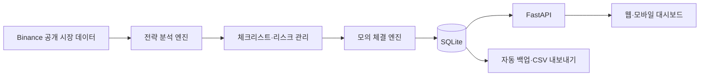

# CoinPilot Lab

> 실거래 전에 자동매매 전략을 검증하는 클라우드 기반 암호화폐 모의매매·리스크 관리 플랫폼

CoinPilot Lab은 BTC·ETH·SOL 시장 데이터를 24시간 수집하고 매매 전략을 모의매매로 실행해 성과와 위험을 분석합니다. 포지션 크기, 손절 기준과 일일 손실 한도를 관리하며, 웹과 모바일에서 가상 잔고·포지션·손익·거래 기록과 전략 판단 근거를 확인할 수 있습니다.

현재 버전은 **전략 검증용 MVP**입니다. 선물 모의매매는 실제 Binance USDT-M 공개 데이터를 사용하지만 거래소 주문을 전송하지 않습니다. 현물 주문 경로는 코드로 구현되어 있으나 실제 계정 검증을 마치지 않았습니다.

## 제품이 해결하는 문제

개인 투자자는 충분히 검증하지 않은 전략을 실거래에 적용하거나, 손절과 거래 중단 기준 없이 감정적으로 매매하면서 손실을 키울 수 있습니다. 전략을 장시간 검증하려면 개인 PC를 계속 켜야 하고, 거래 기록·수수료·손실 위험을 직접 정리해야 하는 어려움도 있습니다.

CoinPilot Lab은 다음 과정을 하나의 서비스로 연결합니다.

- VPS 기반 24시간 시장 데이터 수집
- 백테스트와 모의매매를 통한 전략 검증
- 포지션 크기와 손실 한도를 적용한 위험 관리
- 모든 매매 판단과 결과 기록
- 웹 대시보드를 통한 성과 확인

## 주요 사용자

- 선물 매매를 공부하며 실거래 전 검증이 필요한 사용자
- 자신이 만든 전략을 비교하려는 개인 개발자
- 매매 교육을 운영하는 강사와 커뮤니티
- 여러 전략의 성과와 위험을 관리하려는 소규모 트레이딩 팀

## 주요 기능

| 기능 | 설명 | 상태 |
|---|---|:---:|
| 다중 종목 모의매매 | BTC·ETH·SOL 선물 전략을 독립된 가상 계좌로 실행 | 완료 |
| 시장 사이클 분석 | 일봉·4시간봉 SMA 50/200으로 상승·하락 사이클 판단 | 완료 |
| 진입 근거 분석 | 거래량, 매물대, 다이버전스, 트랩과 공개 OI 검토 | 완료 |
| 리스크 관리 | 거래당 손실, 일일 손실, 레버리지와 거래 횟수 제한 | 완료 |
| 매매 기록 | 전략 판단, 진입·청산, 수수료와 손익을 SQLite에 저장 | 완료 |
| 웹 대시보드 | 잔고, 포지션, 누적 손익, 최근 거래와 판단 조회 | 완료 |
| VPS 운영 | Docker 기반 24시간 실행, 자동 재시작과 매일 백업 | 완료 |
| 백테스트 보고서 | 과거 데이터 기반 수익률·최대 낙폭·위험 분석 | 예정 |
| 선물 테스트넷 주문 | Binance Futures 테스트넷 주문과 체결 검증 | 예정 |
| 사용자 계정·알림 | 계정별 전략 분리와 진입·청산·위험 알림 | 예정 |

## 서비스 이용 흐름

1. 사용자가 종목, 전략과 최대 허용 손실을 설정합니다.
2. 과거 데이터 백테스트로 전략의 기본 성과를 확인합니다.
3. BTC·ETH·SOL 모의매매를 VPS에서 24시간 실행합니다.
4. 웹 대시보드에서 거래 결과와 판단 근거를 검토합니다.
5. 검증 기준을 통과한 전략은 Binance 테스트넷에서 주문 안정성을 확인합니다.
6. 사용자가 위험을 이해하고 직접 결정한 경우에만 거래소 연동 단계로 이동합니다.

현재 구현 범위는 3~4단계입니다. 백테스트 보고서와 선물 테스트넷 주문은 개발 로드맵에 포함되어 있습니다.

## 제품의 차별점

- 백테스트, 장기 모의매매, 테스트넷 검증을 순서대로 수행하는 구조
- 수익률과 함께 수수료, 최대 손실과 거래 중단 조건을 관리
- 결과뿐 아니라 진입·관망·차단 판단의 근거까지 기록
- 거래당 최대 손실액에서 손절 거리와 주문 수량을 역산
- 개인 PC 없이 VPS에서 실행하고 웹·모바일에서 상태 확인
- 지역 제한과 접근 제한이 발생하면 자동 우회하거나 주문을 반복하지 않고 중단

## 시스템 구성



| 구성 요소 | 역할 |
|---|---|
| `futures_strategy.py` | 시장 사이클과 진입·청산 후보 판단 |
| `futures_risk.py` | 포지션 크기, 수수료와 손실 한도 계산 |
| `futures_paper.py` | 공개 시세 기반 모의 체결과 상태 저장 |
| `paper_data.py` | 상태 확인, 안전한 백업과 CSV·JSON 내보내기 |
| `web_app.py` | 읽기 전용 웹 대시보드와 JSON API |

## 예상 수익 모델

아래 가격은 사업성 검토를 위한 초기 가설이며 사용자 조사와 운영비 검증 후 조정합니다.

| 요금제 | 예상 가격 | 제공 기능 |
|---|---:|---|
| Free | 무료 | 1개 전략, 기본 모의매매와 성과 요약 |
| Basic | 월 9,900원 | 3개 종목, VPS 실행과 웹 대시보드 |
| Pro | 월 29,000원 | 백테스트, 다중 전략과 상세 위험 분석 |
| Business | 별도 협의 | 강사·커뮤니티용 회원 관리와 전략 비교 |

초기 서비스는 모의매매·백테스트·성과 분석을 중심으로 제공할 계획입니다. 거래소 주문 연동은 기술 검증과 관련 법률·거래소 정책 검토 후 별도 범위로 다룹니다.

## 구현 현황과 로드맵

### 구현 완료

- BTC·ETH·SOL 선물 모의매매와 롱·숏 전략
- 다중 시간대 사이클·다이버전스·트랩·거래량·OI 분석
- 거래당 0.5%, 일일 3R, 최대 2배 레버리지 기반 초기 위험 설정
- 모든 전략 판단과 거래 결과의 SQLite 기록
- Docker Compose와 systemd 기반 VPS 운영
- 실행 중 DB 백업과 CSV·JSON 내보내기
- 모바일 대응 읽기 전용 웹 대시보드
- 자동 테스트 51개

### 다음 개발 단계

1. 과거 펀딩비와 수수료를 포함한 백테스터 및 성과 보고서
2. 웹 차트, 기간별 수익률, 최대 낙폭과 승률 통계
3. 사용자 로그인과 계정별 전략·데이터 분리
4. Binance Futures 테스트넷 주문 실행기
5. 부분 체결, 주문 응답 유실과 재시작 상태 동기화
6. 진입·청산·손실 한도 도달 모바일 알림

## 기술과 문서

- Python 3.12, CCXT, FastAPI, SQLite
- Docker Compose, systemd
- [선물 전략 명세](STRATEGY.md)
- [강의 기반 체크리스트·리스크 규칙](COURSE_SPEC.md)
- [VPS 배포와 백업](DEPLOYMENT.md)

기본 실행은 실제 시세를 이용한 로컬 모의매매입니다. Binance 테스트넷 주문과는 다릅니다.

## 개발 기록 — 2026-11-09

오늘 프로젝트의 기본 구조부터 선물 매매 계획 엔진까지 구현했습니다.

### 현물 봇

- Binance 공개 시세를 사용하는 BTC/USDT 현물 SMA 5/20 교차 전략을 구현했습니다.
- 기본 실행은 실제 주문이 없는 로컬 모의매매이며, `--live`와 확인 문구를 모두 입력해야만 현물 실거래 경로가 열립니다.
- SQLite에 잔고·포지션·마지막 처리 봉·주문 상태를 저장합니다.
- 같은 상태 DB의 중복 실행을 잠금 파일로 차단하고, 응답이 불확실한 주문은 자동 재주문하지 않고 정지시킵니다.
- Windows와 Linux/macOS에서 같은 잠금 방식을 사용할 수 있도록 `portalocker`를 적용하고 PowerShell 실행 방법을 추가했습니다.

### 네트워크 대응

- 외부 요청에 기본 3.5초 타임아웃을 적용했습니다.
- 공개 시장 데이터만 `api.binance.com`, `api1`, `api2`, `api3` 순서로 제한적으로 폴백합니다.
- 451 지역 제한과 403/418/429 접근·요청 제한에는 폴백하지 않고 정지합니다.
- 잔고 조회와 실제 주문은 자동 재시도하거나 다른 호스트로 전환하지 않습니다.

### 선물 전략과 강의 내용 반영

- 완성된 일봉과 4시간봉의 SMA 50/200으로 큰 시장 사이클을 판정합니다.
- 완성된 15분봉의 작은 사이클 변곡으로 롱·축소 숏·관망·청산 후보를 만듭니다.
- 다이버전스, 불/베어 트랩, 상대 거래량, OI·펀딩 맥락과 시간 손절을 독립적인 근거 함수로 구현했습니다.
- 강의의 7개 진입 전 체크리스트를 점수제가 아닌 필수 검토 절차로 구현했습니다.
- 손절가를 먼저 정한 뒤 수수료·슬리피지·펀딩 버퍼를 포함해 1R 이내 수량을 계산합니다.
- 모의 테스트 시작값으로 거래당 0.5%, 일일 3R, 최대 2배 레버리지, 연속 손실 3회, 하루 6회 거래 제한을 적용했습니다. 이 값들은 강의에서 제시한 고정값이 아니므로 백테스트 후 조정해야 합니다.
- 수익 중인 포지션에 확인 신호가 있을 때만 추가 진입을 허용하고, 손절 확대와 물타기를 차단했습니다.
- 25%씩 네 번 나누는 익절 계획을 선택 기능으로 구현했습니다.

### 24시간 데이터 수집

- Docker Compose로 BTC·ETH·SOL 모의매매를 각각 독립 실행할 수 있습니다.
- 모든 15분봉 판단과 모든 청산 거래를 SQLite 테이블에 제한 없이 누적합니다.
- 실행 중에도 안전한 DB 백업과 JSON·CSV 내보내기를 지원합니다.
- systemd로 서버 부팅 시 자동 시작하고 하루 한 번 DB를 백업할 수 있습니다.
- Docker 로그는 크기와 파일 수를 제한해 서버 디스크가 로그로 가득 차는 것을 막습니다.
- 읽기 전용 웹 대시보드에서 BTC·ETH·SOL 잔고, 포지션, 누적 손익, 최근 거래와 전략 판단을 확인할 수 있습니다.

### 현재 검증 상태와 다음 작업

- 전체 자동 테스트 **51개**가 통과했습니다.
- Python 문법 검사와 의존성 검사도 통과했습니다.
- 현물 주문 경로는 구현됐지만 실제 계정에서 검증하지 않았습니다.
- 선물 모의매매 실행기는 공개 USDT-M 시세로 가상 진입·청산·손익 기록까지 수행하지만 거래소 주문을 전송하지 않습니다.
- 다음 단계는 과거 펀딩까지 포함한 백테스트, 임계값 결정, 선물 테스트넷 주문 실행기, 서버 측 손절·익절 주문, 재시작·부분 체결 상태 동기화입니다.

## 설치 및 실행

```sh
python3 -m venv .venv
.venv/bin/python -m pip install -r requirements.txt
.venv/bin/python -m pytest -q
.venv/bin/python bot.py --once
.venv/bin/python bot.py
```

### Windows PowerShell

Python 3.12를 설치하고 프로젝트 파일을 PC에 내려받은 뒤, `bot.py`가 있는 폴더에서 PowerShell을 여세요. GitHub 저장소에서 Code → Download ZIP을 선택해 내려받거나 Git으로 복제할 수 있습니다.

```powershell
py -3.12 -m venv .venv
.\.venv\Scripts\python.exe -m pip install -r requirements.txt
.\.venv\Scripts\python.exe -m pytest -q
.\.venv\Scripts\python.exe bot.py --once
```

계속 모의매매하려면:

```powershell
.\.venv\Scripts\python.exe bot.py
```

가상환경 활성화가 필요 없어 PowerShell 실행 정책을 변경하지 않아도 됩니다. `py`를 찾지 못하면 Python 설치 및 Python Launcher 설치 여부를 확인하세요. `--once`가 출력 없이 정상 종료할 경우 시세 조회는 완료했지만 매매 신호가 없었던 것입니다. `--live`를 지정하지 않으면 실제 주문을 보내지 않으며 API 키도 필요하지 않습니다. 종료는 Ctrl+C입니다. Windows와 Linux/macOS에서 파일 잠금은 `portalocker`로 처리합니다.

현재 클라우드에서는 `.venv/bin/python` 대신 `/workspace/coin-bot-venv/bin/python`을 사용할 수 있습니다.

기본 전략: BTC/USDT, 1분 봉의 5/20 단순이동평균 교차. 완성된 봉에서 상승 교차 시 시장가 매수, 하락 교차 시 봇이 보유한 수량만 매도합니다. 기본 가상 자본은 100 USDT, 매수 금액은 10 USDT, 모의 수수료는 0.1%입니다. `--symbol`, `--timeframe`, `--fast`, `--slow`, `--capital`, `--quote-amount`, `--fee`로 조정합니다. 매매 신호가 없으면 주문하지 않습니다.

상태는 SQLite에 저장하며 같은 데이터베이스를 쓰는 동시 실행은 차단합니다. 모드·전략을 변경할 때는 별도 `--state` 경로를 사용하세요. 종료는 Ctrl+C입니다. 종료해도 보유 코인은 자동으로 매도하지 않습니다.

## 선물 모의매매 실행

`futures_paper.py`는 Binance USDT-M의 공개 일봉·4시간봉·15분봉과 OI를 읽습니다. API 키 없이 로컬에서 가상 체결만 기록하며 실제 주문 함수는 호출하지 않습니다.

Windows PowerShell에서 한 번만 실행해 상태를 확인하려면:

```powershell
.\.venv\Scripts\python.exe futures_paper.py --once
```

계속 실행하려면:

```powershell
.\.venv\Scripts\python.exe futures_paper.py
```

기본 설정은 BTC/USDT 무기한 선물, 가상 자본 1,000 USDT, 레버리지 상한 2배, 거래당 위험 0.5%, 일일 손실 3R, 롱 전용입니다. 숏 모의매매도 허용하려면 기존 롱 전용 상태와 분리된 DB를 사용하세요.

```powershell
.\.venv\Scripts\python.exe futures_paper.py --allow-short --state futures-paper-long-short.sqlite3
```

프로그램은 매분 확인하지만 새 15분봉이 완성됐을 때만 전략을 처리합니다. `wait`, `blocked`, `entry`, `hold`, `exit` 이벤트를 JSON 한 줄로 출력하고 `futures-paper.sqlite3`에 저장합니다. 상태 JSON에는 빠른 조회용 최근 100개 청산 기록을 유지하고, 전체 기록은 별도 테이블에 보존합니다. 설정을 변경할 때는 다른 `--state` 파일을 지정해야 합니다.

DB의 `events` 테이블에는 모든 15분봉 판단, `trades` 테이블에는 모든 청산 거래가 제한 없이 누적됩니다. 상태 확인과 실행 중 백업·CSV 내보내기는 다음처럼 사용할 수 있습니다.

```powershell
.\.venv\Scripts\python.exe paper_data.py status --state futures-paper.sqlite3
.\.venv\Scripts\python.exe paper_data.py backup --state futures-paper.sqlite3 --output backup.sqlite3
.\.venv\Scripts\python.exe paper_data.py export --state futures-paper.sqlite3 --output-dir exports\btc-v1
```

엄격 체크리스트가 기본이며 상대 거래량, 최근 거래 집중 가격대, 가격 구조와 공개 OI 검토를 통과해야 진입합니다. 현재 펀딩비는 위험 버퍼에만 반영하고 실제 펀딩 지급·수취는 가상 잔고에 반영하지 않습니다. 과거 수익률이나 실거래 수익을 보장하지 않습니다.

## 웹 대시보드

웹 화면은 모의매매 SQLite DB를 읽기 전용으로 열며 주문을 실행하거나 전략 설정을 변경하지 않습니다. 로컬에서 확인하려면 DB가 있는 디렉터리를 지정하고 서버를 실행합니다.

```sh
PAPER_DATA_DIR=. .venv/bin/uvicorn web_app:app --host 127.0.0.1 --port 8080
```

브라우저에서 `http://127.0.0.1:8080`을 열면 됩니다. 화면은 30초마다 갱신되며 JSON 상태는 `/api/dashboard`, 프로세스 상태는 `/health`에서 확인할 수 있습니다.

Docker Compose에서는 `dashboard` 서비스가 함께 시작되지만 호스트의 `127.0.0.1:8080`에만 연결됩니다. 비밀번호와 HTTPS 없이 인터넷에 직접 공개하지 마세요. 외부 기기에서는 SSH 터널 또는 Tailscale Serve를 사용합니다.

이 클라우드에서는 Binance Futures가 HTTP 451을 반환했지만, 사용자의 Windows 네트워크에서 접속 가능한 경우 위 명령으로 실행할 수 있습니다. 로컬에서도 451이 발생하면 우회하지 말고 계정·지역 이용 가능 여부를 Binance에 확인하세요.

## 실거래

실거래 주문 경로는 구현했지만 실제 계정에서 검증하지 않았습니다. 손절, 최대 손실 제한, 자동 주문 복구, 슬리피지 제한은 아직 없습니다. 모의매매와 주문 테스트를 충분히 검증한 후 사용하세요. 전략 수익성은 검증되지 않았습니다.

여기의 실거래 경로는 **현물 봇만** 가리킵니다. 선물 모의매매는 `futures_system.py`가 만든 `TradePlan`을 로컬 가상 체결에만 사용하며 실제 주문 전송 경로가 없습니다.

전용 계정/API 키 사용을 권장합니다. 출금 권한 없이 현물 거래 권한만 부여하세요. `BINANCE_API_KEY`와 `BINANCE_API_SECRET`을 안전한 실행 환경에서 공급해야 합니다. 키를 코드·Git·채팅에 넣지 마세요. Binance HMAC 서명에는 프로세스가 사용할 수 있는 실제 secret이 필요하며 HTTPS 프록시 치환용 placeholder는 사용할 수 없습니다.

직접 실행하려면 다음 두 옵션을 함께 지정해야 합니다:

```sh
.venv/bin/python bot.py --live --confirm-live BINANCE_SPOT_REAL_ORDERS --state live.sqlite3 --quote-amount 10 --capital 100
```

`--capital`은 봇 내부 예산이며 계좌 전체 잔고가 아닙니다. 봇은 단일 포지션만 유지합니다. 시장가 체결 금액은 가격 변동으로 설정한 매수 금액을 초과할 수 있습니다. 최소 주문 수량/금액을 충족하지 못하면 정지합니다. 수수료와 정밀도로 발생한 잔여 수량은 수동 확인이 필요할 수 있습니다.

주문 전 intent를 영구 저장합니다. 응답 유실, 부분 체결 또는 불명확한 응답이면 실행 및 재시작을 중단하며 자동 재주문하지 않습니다. 바이낸스에서 `spotbot-<봉 timestamp>-<buy/sell>` 주문 ID를 조회하여 체결·잔고를 확인하고 DB를 백업한 뒤 상태를 수동 조정해야 합니다. 미해결 상태를 지우거나 새 DB로 무작정 재시작하면 중복 주문이 생길 수 있습니다. 여러 DB로 같은 계정을 동시에 운영하지 마세요.

## 네트워크

`api.binance.com` HTTPS 접근이 필요합니다. 클라우드 프록시와 CA 설정을 그대로 사용하고 TLS 검증을 유지합니다. 지역 제한이나 네트워크 오류를 우회하지 않습니다. 오류가 나면 봇은 정지합니다.

## 타임아웃과 공개 API 장애 대응

[참고 글](https://velog.io/@whird625/바이낸스-에러-해결)의 타임아웃과 다중 호스트 접근을 현물 봇에 맞게 적용했습니다.

요청 타임아웃은 기본 3,500ms이며 `--timeout-ms`로 변경합니다. 이는 요청별 제한이며 전체 실행 시간을 3.5초로 제한하는 것은 아닙니다. 공개 시장정보·봉 조회가 타임아웃 또는 일시적 서버/연결 오류로 실패하면 `api.binance.com`, `api1.binance.com`, `api2.binance.com`, `api3.binance.com` 순서로 최대 한 번씩 시도합니다. 이 호스트들도 클라우드 네트워크 허용 목록에 있어야 합니다.

451 지역 제한 및 403/418/429 접근 제한·요청 제한에는 폴백하지 않고 정지합니다. 실거래 잔고 조회와 주문 전송은 기본 호스트를 유지하고 자동 재시도하지 않습니다. `data-api.binance.vision`은 주문을 처리하는 API가 아니므로 주문 대상으로 추가하지 않았습니다. 리전 변경은 이 프로젝트의 코드 설정으로 할 수 없으며, 현재 클라우드에서 반환된 451의 정확한 지역 원인은 확인되지 않았습니다.
